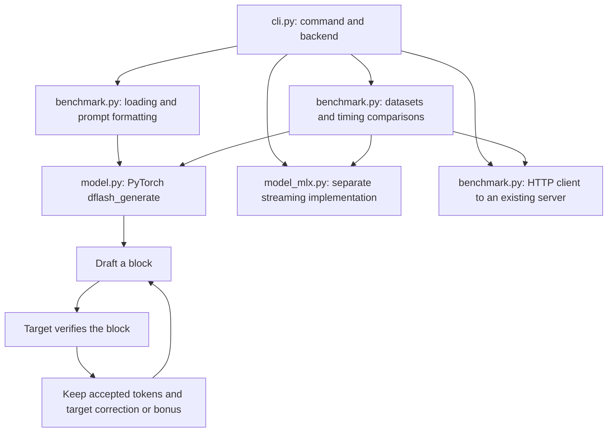

# Learn this repository with CodeTour

Start with **1 - Find your way around**. The five files in [`.tours/`](../.tours) are JSON documents with the `.tour` extension, which CodeTour discovers automatically. You do not need to install this Python project or download model weights to read them.

## Open the tours

1. Open this workspace's repository root in VS Code: the folder containing `pyproject.toml`, `dflash/`, and `.tours/`. From the Conductor workspace terminal, `code .` opens that exact folder if the VS Code shell command is installed. Otherwise use VS Code's **File → Open Folder**. Do not open only the `.tours` folder.
2. Install **CodeTour**, extension ID **`vsls-contrib.codetour`**, from VS Code Extensions. This repository recommends it in `.vscode/extensions.json`. The optional terminal command is `code --install-extension vsls-contrib.codetour`.
3. Open the Command Palette with **Cmd+Shift+P** on macOS, or **Ctrl+Shift+P** on Windows/Linux. Run **CodeTour: Start Tour**, then select **1 - Find your way around**. You can also start a tour from the **CODETOUR** view in Explorer.
4. Read the explanation beside the highlighted code, then use the tour's next/previous controls. `Next Tour` links connect the five tours in order. Stop after a tour if you need a break.

These are CodeTour files for a compatible editor extension. Conductor manages the workspace; opening JSON as text in its file viewer is not the same as playing a tour. The format, playback, and linking behavior are documented in the [official CodeTour repository](https://github.com/microsoft/codetour).

## Choose your route

| Tour | What you should be able to explain afterward | Suggested time |
| --- | --- | --- |
| [1 — Find your way around](../.tours/01-start-here.tour) | Which modules own generation, backends, and reporting | 10 minutes |
| [2 — Trace one greedy decoding block](../.tours/02-decoding-loop.tour) | Anchor, proposals, shifted verification, bonus, and cache rollback | 15 minutes |
| [3 — Understand the draft model](../.tours/03-drafter-internals.tour) | How target features and block embeddings become proposals | 15 minutes |
| [4 — Compare backends and sampling paths](../.tours/04-backends-and-sampling.tour) | CUDA versus MLX, cache rollback, stochastic sampling, and server boundaries | 15 minutes |
| [5 — Read benchmarks and plan your first change](../.tours/05-benchmark-and-modify.tour) | Baselines, acceptance accounting, timing denominators, and missing checks | 15 minutes |

The times are planning estimates, not measured learning guarantees. To find where a future draft-refinement experiment would fit, take 1 → 2 → 5 and return to 3 before changing model internals. Use 4 to understand platform and sampling differences. The tours assume basic Python. Their tensor notation is introduced in tour 3; use the tutoring prompt below if it needs unpacking.

## Keep this map in mind



This is the upstream inference baseline. It includes no custom conditional-redrafting observer, trained refiner, or experiment-report writer.

## Turn reading into understanding

For each checkpoint, say or write your prediction **before** opening the [answer key](TOUR_CHECKPOINTS.md). Then locate the expression that supports the answer. If you are wrong, explain which assumption failed. At the end of a tour, close its description and sketch the flow from memory.

Tomorrow, try the questions again without the files open. Revisit difficult ones several days later. Retrieval and spacing have research support in learning tasks; this specific schedule is a practical suggestion rather than an experimentally optimized schedule for this codebase. The evidence and its limits are in [Tour prompts and research](TOUR_PROMPTS.md).

One useful tutoring request is:

```text
Use .tours/02-decoding-loop.tour to tutor me one step at a time.
I know basic Python but am learning speculative decoding. Before revealing
each checkpoint answer, ask for my prediction and wait. Check my answer
against the actual code, explain the smallest missing concept, and ask one
transfer question with different token IDs. Do not edit the implementation
or download models. Start with the anchor/proposal distinction.
```

## Try the lightweight checks

Run these from the repository root:

```bash
python3 scripts/validate_tours.py
python3 -m dflash.cli --help
python3 -m dflash.cli generate --help
python3 -m dflash.cli benchmark --help
```

These commands use the standard library and require no model downloads. They check navigation and CLI wiring, not inference correctness. The upstream baseline contains a package-build/smoke workflow but no inference test suite. Before modifying generation, add targeted checks for target-output agreement, cache alignment, sampling, stop tokens, and short output budgets as appropriate to your change.

For actual inference, follow [Install for inference](../README.md#install-for-inference) and the [upstream examples](UPSTREAM_README.md). Local inference may download weights and benchmarks may download datasets. The Transformers CLI selects CUDA; MLX is the separate Apple Silicon path. Benchmarks print summaries to the terminal. They do not currently produce the earlier project's experiment JSON reports, and the local benchmark does not assert exact equality between baseline and speculative token IDs.

## When files change

Each step uses a unique regular-expression `pattern` anchored to a source line, rather than a fixed line number. Inserting lines elsewhere therefore usually preserves navigation. Renaming or editing the matched line requires updating the pattern and reviewing the explanation. No tour is pinned to an old commit, so playback follows the currently checked-out code.

Run `python3 scripts/validate_tours.py` after edits. It checks JSON structure used by these tours, paths, unique pattern matches, optional line bounds, and tour links. It does not prove that explanations are true; use the source-review prompt in [TOUR_PROMPTS.md](TOUR_PROMPTS.md). The checked-in tours were also validated against the [official schema](https://aka.ms/codetour-schema).

If tours do not appear, verify the extension is enabled, open the repository root, and run **Developer: Reload Window**. If a step opens the wrong code, run the validator and inspect its pattern. Plain-text fallback: open a `.tour` file, read its `description` fields, and find each named symbol in its `file`.
