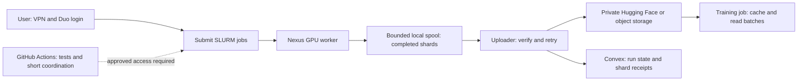

# Nexus compute and external dataset storage

Use Nexus for GPU generation, external file storage for the training corpus, and
optionally Convex for job and shard metadata. GitHub Actions can coordinate short
operations once school-approved connectivity and authentication exist. A Convex
API key alone does not provide access to Nexus or another storage service.

This is an implementation plan, not a deployed upload service. No runner has been
registered, Convex deployment changed, or training data uploaded by this plan.
The read-only [progress script](../scripts/summarize_qwen_responses.py) is implemented
and tested; the publisher and coordination workflow below remain proposed.

## Existing collection and live inspection

The source cache contains 215,337 usable unique training prompts. The current
larger export selects 50,000 training and 1,024 validation prompts from that pool.
The separate 384-prompt pilot overlaps the training export: adding its responses
to the larger run does not add 384 distinct prompts. Neither run yet captures
DFlash features or teacher/editor continuation examples.

The previously submitted jobs are pilot `8146716` and array `8146717` (64 shards,
three concurrent GPU workers). Last known state from November 3 was running; it
must not be presented as the current state without a fresh check.
The November 5 inspection attempt reached password authentication and sent a Duo
Push, which expired before approval. No new remote counts or quota usage were
obtained. The local pilot copy still contains only the four earlier downloaded
responses; it is not a mirror of current Nexus progress.

After VPN, SSH, and Duo authentication, query SLURM on the submission node:

```bash
cd /fs/classhomes/fpajak/speculative-decoding-project
squeue -u fpajak
sacct -j 8146716,8146717 --format=JobID,State,ExitCode,Elapsed,NodeList
```

Copy the new progress script to the same relative path on Nexus before using it.
Run the larger journal scan on an allocated CPU, without requesting a GPU:

```bash
srun --partition=class --account=class --qos=default \
  --cpus-per-task=1 --mem=2G --time=00:10:00 \
  .venv-qwen/bin/python scripts/summarize_qwen_responses.py \
  data/qwen_responses_pilot data/qwen_responses_50k > qwen-progress.json
```

This script bounds each read at the file's opening size, checks record checksums
and run/shard identity, and leaves incomplete final records untouched. It reports
generated responses, EOS endings, length caps, skips, remaining work, token and
byte counts, and unique source IDs across runs. It does not lock or modify active
journals. Counts are observations over an interval, not one atomic cluster-wide
snapshot; SLURM state comes from the separate commands above. Full verification
against the original inputs remains the generator's `--verify-only` operation
after each writer stops.

## Capacity and destination

| Location | Verified limit or planning role | Decision |
| --- | --- | --- |
| Nexus class home | 30 GB quota; model weights alone are 16.38 GB, plus roughly 6 GiB for the environment | Small working area; measure user quota, not just filesystem free space |
| Nexus extra project storage | Up to another 100 GB per student can be requested through the TA/instructor | Useful staging space; not an independent long-term backup |
| Private Hugging Face dataset | Free account currently includes 100 GB private storage across the account | Recommended first destination for text/token exports |
| Object storage, such as S3-compatible R2 | Scales beyond free dataset quotas, with usage charges | Recommended for large feature/tensor shards |
| Convex free tier | 0.5 GB database, 1 MiB/document, 1 GB files, 1 GB/month file egress | Store run/shard metadata, not the bulk training corpus |

These are published limits checked November 5, 2026, not measurements of remaining
space in the user's accounts. See [UMIACS class storage](https://wiki.umiacs.umd.edu/umiacs/index.php/ClassAccounts),
[Hugging Face storage](https://huggingface.co/docs/hub/storage-limits), and
[Convex limits](https://docs.convex.dev/production/state/limits).

R2 Standard currently lists $0.015/GB-month, 10 GB-month free, and no Internet
egress charge; requests are separately metered. For illustration, 200 GB retained
for a month costs about $2.85 for storage after the allowance, before request
charges and taxes. This is an option to price, not an account or purchase already
configured. [R2 pricing](https://developers.cloudflare.com/r2/pricing/).

The expensive stage may be saved model computations rather than text. One
**hypothetical** BF16 feature array of 16 positions by 4,096 dimensions is 128 KiB
per context. At 50,000 responses and 32 contexts each, that one array alone is
about 195 GiB (209.7 GB). Extra layers, logits, or KV caches multiply storage.
Measure actual bytes/context, contexts/second, and compression on the pilot before
committing to a larger feature run; tensor compression may save little.

The editor's roughly 100M parameters do not by themselves establish a minimum
dataset size. Use the existing 384-prompt pilot to establish the feature/label
contract, then a 3K/10K/50K learning curve with fixed validation. More Qwen text
alone is not yet more editor training examples. See [training-data design](TRAINING_DATA.md).

## Proposed data flow



1. **Pin the run.** Record dataset hash, model revision, generation settings,
   tokenizer/runtime, feature schema, split assignment, code revision, and worker
   assignment. Keep the existing run intact: active/queued workers pin the current
   generator's bytes, so replacing its code mid-run will break resumption.
2. **Generate locally and seal chunks.** Future feature workers write to temporary
   files, flush them, and atomically rename complete chunks. Start with roughly
   128–256 MiB chunks and tune after measurement. Current Qwen journals are already
   small per worker; publish them only after the writer finishes or from a verified
   immutable snapshot. Never upload a file while it is still being appended.
3. **Upload directly from a compute allocation.** Keep exact token IDs and provenance
   in compressed Parquet or JSONL, and dense tensors in Safetensors shards. Avoid
   routing bulk bytes through GitHub artifacts or Convex functions. Outbound HTTPS
   to the chosen destination must be tested from an allocated Nexus node.
4. **Confirm durability.** Use stable keys such as
   `runs/<run-hash>/shards/<shard-id>/<sha256>`. Retry with backoff, reconcile an
   already-uploaded key, and verify remote size and provider-supported checksum
   or downloaded bytes. An ETag is not universally a SHA256. Record a receipt only
   after verification; publish a final dataset manifest after all expected shards
   are accounted for. Object versions or a pinned Hub commit identify training data.
5. **Record metadata.** Upsert one Convex document per run/shard: run ID, shard ID,
   source split, object key/version, SHA256, bytes, record/token counts, lifecycle
   state, attempts, and timestamps. Use an indexed unique application identity
   `(run_id, shard_id, content_hash)` and a transaction to avoid duplicate receipts.
   Do not store tensors, secrets, or expiring signed URLs in these documents.
6. **Apply backpressure.** Bound pending local uploads against measured quota,
   reserve space for the environment/model and the next complete chunk, and stop
   producing safely when uploads cannot keep up. Resume after uploads recover.
   Streaming still needs a local buffer; network outages cannot be solved by
   silently dropping data.
7. **Prune only with resumability.** Keep the only copy until upload verification
   and a durable manifest exist. The existing collector uses its local journal to
   know which prompts are complete. Deleting it now would regenerate work. A future
   publisher must either restore journals before resuming or add an immutable
   completion index and test that path before automatic cleanup is enabled.
8. **Train near cached shards.** Fetch files in batches with local caching and
   prefetch. Re-downloading the full corpus each epoch can dominate time and
   transfer charges. Keep all contexts and prefix alternatives from a prompt in
   that prompt's split; all comparison methods read the same manifest/order.

If upload succeeds but the Convex update fails, reconcile the object and retry
the metadata update. Convex and external storage do not share a transaction.
Manifest/receipt reconciliation must also recover a worker killed between those
steps. Initial rollout should keep local data even after upload.

## What GitHub Actions can and cannot do

On November 5 the GitHub API resolved the repository to
`Spec-decoding-project/Speculative-decoding-project`, reported it as **public**,
listed `CONVEX_API_KEY`, and returned zero registered runners and no repository
variables. Only the secret's name/update timestamp were read. Its value/type,
target deployment, and permissions have not been tested. There is no Convex app
or deployment URL in this checkout.

Hosted runners reach the public Internet by default. The class account requires
UMD VPN access, and actual SSH login requires Duo. Adding a Convex secret does not
remove either requirement. Do not put the directory password in a workflow,
automate Duo approval, or deploy an unapproved network tunnel. Ask the TA/instructor
which unattended scheduler access, service identity, or gateway is supported.
[GitHub networking](https://docs.github.com/en/actions/concepts/runners/private-networking),
[UMIACS access](https://wiki.umiacs.umd.edu/umiacs/index.php/ClassAccounts).

The first usable version needs **no cluster GitHub runner**: authenticate once,
submit durable SLURM jobs, and let those jobs upload directly. GitHub can run tests
and deploy the metadata service separately. An SSH disconnect does not stop
already submitted batch jobs.

If fully unattended GitHub submission is required later, use a school-approved
gateway or isolated coordinator with an authorized authentication method. A
restricted private operations repository is preferable for any runner that can
reach the school account. This project's public pull-request workflows must not
run on that machine. GitHub warns against persistent self-hosted runners attached
to public repositories. [Runner security](https://docs.github.com/en/actions/reference/security/secure-use).
Do not assume permission to install a persistent runner on a shared submission
node; computational jobs must go through SLURM.
[Submission-node policy](https://wiki.umiacs.umd.edu/umiacs/index.php/Nexus/Submission_Node_Policy).

The eventual workflow should use manual dispatch from trusted code, read-only
repository permissions, pinned actions, one submission at a time, and an allowlist
of run configurations. Persist the scheduler job ID so retries query an existing
submission instead of creating duplicates. Submit and exit; use separate status
checks. A hosted Actions job has a six-hour limit, while this collection can last
days. Cancelling a workflow must not be assumed to cancel its SLURM jobs.
[Actions limits](https://docs.github.com/en/actions/reference/limits).

## Credentials and inputs still needed for deployment

- **Storage destination:** a dedicated private Hugging Face dataset ID and scoped
  write token for the text phase, or bucket/endpoint/region and scoped object-store
  credentials for larger features. Check actual remaining quota and set a budget.
- **Convex, if used:** deployment URL/project and confirmation of the stored key's
  type. The documented noninteractive CLI variable is `CONVEX_DEPLOY_KEY`; a secret
  named `CONVEX_API_KEY` can only be mapped to it after checking that it is actually
  a deploy key. Management keys and deploy keys are different credentials.
  [Convex deploy keys](https://docs.convex.dev/cli/deploy-key-types).
- **Runtime ingestion access:** deploy an authenticated, narrowly scoped metadata
  endpoint and give workers a separate ingest credential. Do not distribute a
  broad Convex deployment/admin key to GPU workers. The existing repository secret
  can be consumed inside a deliberate Actions deployment workflow; do not export
  it through logs or artifacts to retrieve it locally.
- **Unattended Nexus access:** the institution's supported connectivity/authentication
  method, if moving beyond manual login plus SLURM is necessary.
- **Feature contract:** matched DFlash checkpoint, saved tensors/layers/dtypes,
  prefix selection, labels, and maximum bytes/context before estimating a full run.

GitHub exposes secret metadata through its API; workflow runtime injection is how
the value is used. A secret's existence does not prove it is valid.
[GitHub secrets](https://docs.github.com/en/actions/concepts/security/secrets).

## Rollout and acceptance checks

1. Check the current jobs and home usage, inspect EOS/cap/skip counts, and back up
   completed outputs. Do not restart active shards or change their generator.
2. Choose storage and publish one finished pilot shard. Download it again and
   verify hashes, token IDs, counts, and provenance before enabling more uploads.
3. Test interrupted uploads, expired credentials, storage exhaustion, duplicate
   retries, Convex failure after object success, and recovery after a worker dies.
   Confirm no unverified local shard is deleted and no duplicate example is added.
4. Run a small DFlash feature pilot, measure actual storage/throughput, then set
   bounded spool, GPU concurrency, and a spending limit. Add automated cleanup only
   after the restoration/resume test succeeds.
5. Add GitHub coordination only after supported school access exists. Keep training
   artifacts out of ordinary Git and retain an off-cluster copy before semester
   cleanup. Fall class storage may be removed as early as January 1, 2027.
   [Class account retention](https://wiki.umiacs.umd.edu/umiacs/index.php/ClassAccounts).

The six offline progress tests cover bounded reads during appends, partial tails without mutation, duplicate
pilot IDs, EOS versus caps/skips, checksum corruption, and run/shard mismatch.
They do not prove uploader reliability: that uploader has not been implemented.
